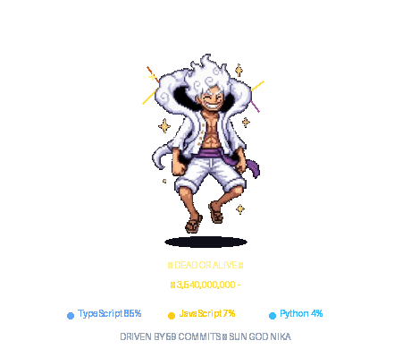
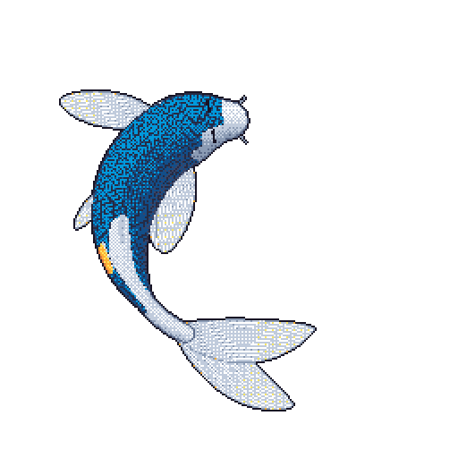

  <h2>R. Sai Dheeraj</h2>
  
<i>Crafting intelligence. Engineering scale.</i>

  

    <b>Founder & CEO, <a href="https://thekairo.tech">Kairo Technologies</a></b> &nbsp;|&nbsp; 
    <b>AI Engineer</b> &nbsp;|&nbsp; 
    <b>Full-Stack Developer</b>
  

  <picture>
    <source media="(prefers-color-scheme: dark)" srcset="https://user-images.githubusercontent.com/19292210/199123129-b9c2437d-4e6d-4f1c-a7ea-d9a91babb41d.gif">
    <source media="(prefers-color-scheme: light)" srcset="https://user-images.githubusercontent.com/19292210/88347096-c067a980-ccfe-11ea-8a06-bdaf552fee06.gif">
    
  </picture>

  Building <b><a href="https://thekairo.dev">Kairo Cloud OS</a></b> — a complete cloud operating system running in a browser tab. 
  Architecting production LLM & RAG systems, autonomous AI agents, and high-performance computing infrastructure.

---

### Ventures & Projects

- **[Kairo Technologies](https://thekairo.tech)** — AI software & cloud computing infrastructure company *(Founder & CEO)*:
  - **[Kairo Cloud OS](https://thekairo.dev)**: Complete cloud operating system running entirely inside a browser tab. Provides a full windowed desktop environment, virtual filesystem, PTY terminal, and native AI assistant—offloading heavy workloads (VS Code, Chrome, 3D/GPU compute) to remote cloud clusters or linked hardware with zero local installation.
  - **[Kairo Orbit](https://orbit.thekairo.dev)**: Autonomous AI operator enabling remote macOS execution and desktop control directly from iOS and Android.
  - **[PAIR](https://pair.thekairo.dev)**: Pet matchmaking and compatibility platform built around how animals actually socialize—helping owners discover compatible companions through rich profiles, preference-based matching, and local discovery.
- **[StakeUp](https://github.com/SaiDheeraj-19/StakeUp)** — 24-hour AI accountability app powered by Groq Vision and Llama 3.2 90B Vision with automated proof verification and escrow staking *(1st Place, Syntax2Code Hackathon)*.
- **[HomeProof](https://github.com/SaiDheeraj-19/HomeProof-APP)** — Real-time property inspection utilizing YOLOv8 for structural damage spotting, Gemini/OpenAI synthesis, and Sarvam AI voice input.
- **[Sonic Bridge](https://github.com/SaiDheeraj-19/SonicBridge)** — Low-latency audio translation engine streaming 1-to-many over WebSockets with VAD and noise suppression in under 6 seconds.

---

### Open Source

- **[vLLM](https://github.com/vllm-project/vllm)** — High-throughput LLM serving engine:
  - Optimized Tensor Parallel Mixture-of-Experts (MoE) collectives with `torch.compile` ([#54611](https://github.com/vllm-project/vllm/pull/54611)).
  - Fixed KV cache group sizing logic for arbitrary hybrid architectures ([#54613](https://github.com/vllm-project/vllm/pull/54613)).
- **[Laya AI](https://github.com/Laya-AI/Laya)** — Non-autoregressive LLM decision-routing engine:
  - Authored per-language temperature calibration at logit scaling ([#127](https://github.com/Laya-AI/Laya/pull/127)) and Chinese eval harness ([#124](https://github.com/Laya-AI/Laya/pull/124)).
  - Built core FastAPI server, concurrent CLI engine, and CI pipelines ([#125](https://github.com/Laya-AI/Laya/pull/125), [#119](https://github.com/Laya-AI/Laya/pull/119), [#114](https://github.com/Laya-AI/Laya/pull/114)).

---

### Tech Stack

- **AI & LLM:** OpenAI, Gemini, Groq, LangChain, LangGraph, LlamaIndex, RAG, Qdrant, pgvector, PyTorch, vLLM
- **Vision & Speech:** OpenCV, YOLOv8, Vision-Language Models, Faster Whisper, Piper TTS, Sarvam AI, Asterisk telephony
- **Full-Stack & Backend:** FastAPI, Node.js, Express, WebSockets, React, Next.js, React Native, Prisma, Redis, Celery, PostgreSQL, MongoDB
- **DevOps & Infra:** Docker, Kubernetes, GitHub Actions, Prometheus, Grafana

---

### Honors & Certifications

- **Hackathons:** 1st Place, Syntax2Code 2026 (Internship Award) • 2nd Place, TechXplore 2026 • 3rd Place, NEXORA 2026
- **Certifications:** Oracle OCI Generative AI Professional • Google Cloud Generative AI Leader • NVIDIA Deep Learning

---

### Observability

  
   
  <strong>SUN GOD NIKA // GEAR 5 (MAX TIER ACCOUNT)</strong>
    
  

    <b>What is this?</b> A living pixel-art companion scaled to my GitHub activity (G1 ➔ G2 ➔ G3 ➔ G4 ➔ <b>G5 MAX</b>). 
    Currently unlocked at <b>Gear 5 [Sun God Nika]</b>—its dynamic Bounty scales directly with commit velocity (฿ 3,540,000,000) and its bone-in meats are glazed by primary repository languages (Python, TypeScript, Rust). 
    <i>Added to replace static contribution blocks with the spirit of boundless freedom and continuous awakening.</i>
  

   
  

    
<b>VIEW COMPANION DIGITAL ECOSYSTEM (ACTIVITY_KOI)</b>

     
    
     
    <i>Sustained craft: Living pixel koi reflecting repository language pigments and calm swimming cadence.</i>
     
  

   
  <strong>SYS_OBSERVABILITY</strong>  
  

 

  <a href="https://linkedin.com/in/sai-dheeraj-r">LinkedIn</a> &nbsp;•&nbsp; 
  <a href="https://saidheeraj.co.in">Portfolio</a> &nbsp;•&nbsp; 
  <a href="https://thekairo.tech">Kairo Technologies</a> &nbsp;•&nbsp; 
  <a href="mailto:16saidheeraj@gmail.com">Email</a>

